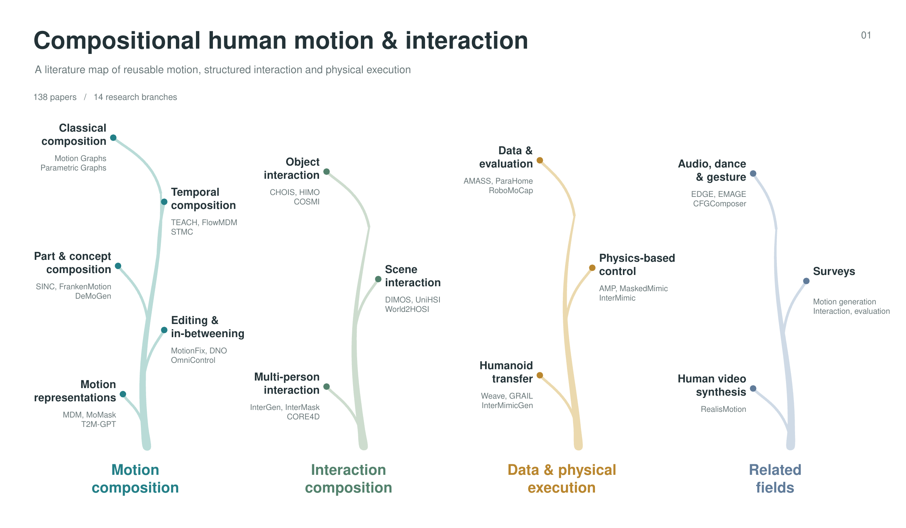
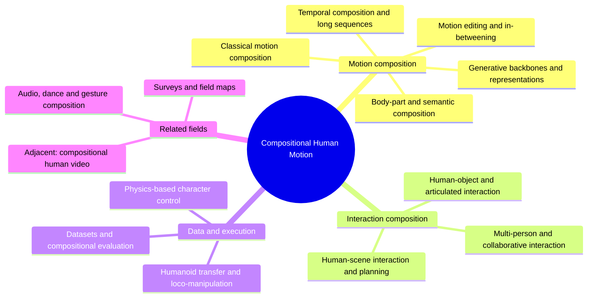

# Compositional Human Motion & Interaction

**A living paper survey of temporal, spatial, semantic, interaction and skill composition for digital humans.**

从经典动作拼接到生成模型、交互与具身执行，按“组合了什么、依赖哪些条件、验证了什么”组织。

Last audit: **2026-11-19** · **138 unique papers** · **138 full-text checks / 0 earlier targeted method readings / 0 abstract-only records** · No external method reproduced.

[Interactive clickable map](https://yutao-yang.github.io/awesome-compositional-human-motion/) · [All audit cards](notes/papers.md) · [Comparison matrix](notes/comparison.md) · [Data & metrics](notes/protocols.md) · [Benchmarks](notes/benchmarks.md) · [中文阅读指南](notes/reading-guide.zh.md) · [BibTeX](references.bib) · [JSON](papers.json) · [Search & inclusion protocol](SEARCH_PROTOCOL.md) · [Maintenance](CONTRIBUTING.md)

> Breadth-first, evidence-labelled curation; not a claim of all-field completeness. Full-text checks include methods, input conditions, split and metrics; earlier targeted method readings are separately labelled. Neither means reproduction. Displayed years use the first preprint where known; venue and cited-version bibliography years are separate.

## Research map

The diagram is a visual overview. Every category and paper in the directory below is a normal clickable link; the interactive map also offers search, evidence filters and expandable paper cards.

[Download editable PowerPoint](figures/compositional-human-motion-taxonomy.pptx) · [Five detailed branch diagrams](figures/README.md)

Text-source taxonomy (Mermaid)

## Clickable directory

- [Classical motion composition](#classics) — 4 papers
- [Temporal composition & long sequences](#temporal) — 13 papers
- [Body-part & semantic composition](#spatial) — 11 papers
- [Motion editing & in-betweening](#editing) — 12 papers
- [Generative backbones & representations](#backbones) — 14 papers
- [Human-object & articulated interaction](#objects) — 19 papers
- [Human-scene interaction & planning](#scenes) — 11 papers
- [Multi-person & collaborative interaction](#people) — 7 papers
- [Datasets & compositional evaluation](#datasets) — 17 papers
- [Physics-based character control](#physics) — 13 papers
- [Humanoid transfer & loco-manipulation](#humanoids) — 6 papers
- [Audio, dance & gesture composition](#audio) — 6 papers
- [Surveys & field maps](#surveys) — 4 papers
- [Adjacent: compositional human video](#video) — 1 papers

## How to read the evidence

- **Abstract**: identity and task-level claims checked against a primary source; detailed protocol remains to be audited.
- **Full text checked**: read the primary methods and experiments, including input contract, data/split, named metrics and limitations. See exact source locators.
- **Earlier targeted method reading**: targeted method/conditions/evaluation reading from the previous release; not yet the same structured audit as the new full-text round.
- **Curator boundary**: limitations distinguish comparison scope from authors’ claims; they do not assert an untested method failure.
- **Official code link**: points to an author-linked repository; availability is not installation, licensing or reproducibility verification.

A long sequence is not automatically compositional generalization. Report unseen source pairings, unseen semantic skill pairings and state-dependent task chains separately.

## Classical motion composition

| Paper | First public / venue | Why it belongs | Evidence | Links |
|---|---|---|---|---|
| **parametric-motion-graphs** — Parametric Motion Graphs | 2007 | Each graph node represents a continuous parameterized motion space constructed by blending aligned examples. Offline sampling finds acceptable transition regions between spaces and stores interpolation structures; runtime queries synthesize a clip and a compatible linear-blend transition rather than merely replaying a discrete edge. | full_text_checked | [Paper](https://graphics.cs.wisc.edu/Papers/2007/HG07/) · [Audit](notes/papers.md#parametric-motion-graphs) |
| **motion-annotations** — Motion Synthesis from Annotations | 2003 | Uses annotated action timelines and multiscale dynamic programming to assemble motion, including overlapping qualitative constraints. | full_text_checked | [Paper](https://escholarship.org/uc/item/23g204tp) · [Audit](notes/papers.md#motion-annotations) |
| **interactive-motion-examples** — Interactive motion generation from examples | 2002 | Cuts and pastes mocap via randomized hierarchical graph search under constraints at interactive speeds. | full_text_checked | [Paper](https://experts.illinois.edu/en/publications/interactive-motion-generation-from-examples/) · [Audit](notes/papers.md#interactive-motion-examples) |
| **motion-graphs** — Motion Graphs | 2002 | Builds a directed graph of captured clips and synthesized transitions; graph walks satisfy user constraints such as locomotion paths. | full_text_checked | [Paper](https://graphics.cs.wisc.edu/Papers/2002/KGP02/) · [Audit](notes/papers.md#motion-graphs) |

## Temporal composition & long sequences

| Paper | First public / venue | Why it belongs | Evidence | Links |
|---|---|---|---|---|
| **prism** — PRISM: Per-unit Kinematic Motion Generation in a Structured Latent Manifold | 2026 | The inspected revision uses a causal temporal VAE with separate kinematic-unit latent tokens, a joint/time structured flow generator, kinematic-tree rotary positional encoding, and depth-dependent flow sampling. A clean-context mask provides prefix continuation and successive segment generation with one frozen generator. | full_text_checked | [Paper](https://arxiv.org/abs/2603.08590) · [Audit](notes/papers.md#prism) · [Code](https://github.com/ZeyuLing/PRISM) |
| **timelinecontrol** — Streaming Multi-Track Timeline Control for 3D Human Motion Generation | 2026 | TimelineControl combines interval-aware conditioning, causal part representations and part-aware denoising with TimelineMotion annotations. | full_text_checked | [Paper](https://arxiv.org/abs/2610.03873) · [Audit](notes/papers.md#timelinecontrol) |
| **dart** — DartControl: A Diffusion-Based Autoregressive Motion Model for Real-Time Text-Driven Motion Control | 2024 / ICLR 2025 as DartControl | Latent diffusion predicts motion primitives from history and current text; noise optimization or RL provides spatial control. | full_text_checked | [Paper](https://arxiv.org/abs/2410.05260) · [Audit](notes/papers.md#dart) |
| **motion-mamba** — Motion Mamba: Efficient and Long Sequence Motion Generation | 2024 | Motion Mamba replaces expensive denoising sequence operations with state-space blocks. Hierarchical Temporal Mamba varies temporal scan depth across the U-shaped network, while Bidirectional Spatial Mamba scans pose features in both directions to couple spatial channels and temporal dependencies. | full_text_checked | [Paper](https://arxiv.org/abs/2403.07487) · [Audit](notes/papers.md#motion-mamba) · [Code](https://github.com/steve-zeyu-zhang/MotionMamba) |
| **stmc** — Multi-Track Timeline Control for Text-Driven 3D Human Motion Generation | 2024 / CVPR Workshops 2024 | Test-time spatial stitching and temporal score arithmetic operate at every diffusion step. | full_text_checked | [Paper](https://openaccess.thecvf.com/content/CVPR2024W/HuMoGen/papers/Petrovich_Multi-Track_Timeline_Control_for_Text-Driven_3D_Human_Motion_Generation_CVPRW_2024_paper.pdf) · [Audit](notes/papers.md#stmc) |
| **flowmdm** — Seamless Human Motion Composition with Blended Positional Encodings | 2024 | FlowMDM generates temporally composed text-conditioned motion and evaluates transition quality. | full_text_checked | [Paper](https://arxiv.org/abs/2402.15509) · [Audit](notes/papers.md#flowmdm) · [Code](https://github.com/BarqueroGerman/FlowMDM) |
| **t2lm** — T2LM: Long-Term 3D Human Motion Generation from Multiple Sentences | 2024 | Uses a local 1D-convolutional VQ-VAE decoder to decode a continuous text-predicted latent stream, trained on short clips. | full_text_checked | [Paper](https://arxiv.org/abs/2406.00636) · [Audit](notes/papers.md#t2lm) |
| **amd-autoregressive** — AMD: Autoregressive Motion Diffusion | 2023 | Introduces HumanLong3D and conditions iterative diffusion generation on current text plus previous text and action sequences. | full_text_checked | [Paper](https://arxiv.org/abs/2305.09381) · [Audit](notes/papers.md#amd-autoregressive) |
| **diffcollage** — DiffCollage: Parallel Generation of Large Content with Diffusion Models | 2023 | DiffCollage represents large content through a factor graph of overlapping smaller regions. It combines local diffusion scores with overlap corrections to approximate a global score, allowing the regions to denoise concurrently. The same construction is applied to images and long human motion. | full_text_checked | [Paper](https://arxiv.org/abs/2303.17076) · [Audit](notes/papers.md#diffcollage) |
| **priormdm** — Human Motion Diffusion as a Generative Prior | 2023 / ICLR 2024 | Introduces DoubleTake sequential composition, ComMDM two-person coordination and DiffusionBlending joint-control model composition. | full_text_checked | [Paper](https://arxiv.org/abs/2303.01418) · [Audit](notes/papers.md#priormdm) · [Code](https://github.com/priorMDM/priorMDM) |
| **st2m** — Sequential Texts Driven Cohesive Motions Synthesis with Natural Transitions | 2023 / ICCV 2023 | Combines previous/current text semantics with learnable transition tokens and a transition loss. | full_text_checked | [Paper](https://openaccess.thecvf.com/content/ICCV2023/papers/Li_Sequential_Texts_Driven_Cohesive_Motions_Synthesis_with_Natural_Transitions_ICCV_2023_paper.pdf) · [Audit](notes/papers.md#st2m) · [Code](https://github.com/Druthrie/ST2M) |
| **multi-act-2022** — MultiAct: Long-Term 3D Human Motion Generation from Multiple Action Labels | 2022 | Recurrently conditions on prior motion and the next action label to generate transitions and long multi-action sequences. | full_text_checked | [Paper](https://arxiv.org/abs/2212.05897) · [Audit](notes/papers.md#multi-act-2022) · [Code](https://github.com/TaeryungLee/MultiAct_RELEASE) |
| **teach** — TEACH: Temporal Action Composition for 3D Humans | 2022 | TEACH extends a text-motion variational Transformer with past-motion conditioning: it generates all frames of one action non-autoregressively, then conditions the next action on a short history. Training on adjacent action pairs teaches continuity; alignment and spherical interpolation further smooth transitions. | full_text_checked | [Paper](https://arxiv.org/abs/2209.04066) · [Audit](notes/papers.md#teach) · [Code](https://github.com/atnikos/teach) |

## Body-part & semantic composition

| Paper | First public / venue | Why it belongs | Evidence | Links |
|---|---|---|---|---|
| **fusion** — FUSION: Full-Body Unified Motion Prior for Body and Hands via Diffusion | 2026 | Unifies body and hand datasets into a full-body motion prior, with optimization-driven object-motion and self-interaction applications. | full_text_checked | [Paper](https://arxiv.org/abs/2601.03959) · [Audit](notes/papers.md#fusion) |
| **frankenmotion** — FrankenMotion: Part-level Human Motion Generation and Composition | 2026 | Learns hierarchical part/action/sequence-conditioned diffusion instead of test-time pose stitching. | full_text_checked | [Paper](https://arxiv.org/abs/2601.10909) · [Audit](notes/papers.md#frankenmotion) |
| **mixermdm** — MixerMDM: Learnable Composition of Human Motion Diffusion Models | 2025 | Learns adversarial dynamic mixing of pretrained single-person and interaction diffusion models. | full_text_checked | [Paper](https://arxiv.org/abs/2504.01019) · [Audit](notes/papers.md#mixermdm) |
| **salad** — SALAD: Skeleton-aware Latent Diffusion for Text-driven Motion Generation and Editing | 2025 | Models joint-frame-word relationships and edits generated motion by cross-attention modulation without explicit user masks. | full_text_checked | [Paper](https://arxiv.org/abs/2503.13836) · [Audit](notes/papers.md#salad) |
| **demogen** — Towards Decompositional Human Motion Generation with Energy-Based Diffusion Models | 2025 / CVPR 2026 | Trains compositional scores to reconstruct holistic motion without individual-concept motion targets. | full_text_checked | [Paper](https://openaccess.thecvf.com/content/CVPR2026/papers/Zhang_Towards_Decompositional_Human_Motion_Generation_with_Energy-Based_Diffusion_Models_CVPR_2026_paper.pdf) · [Audit](notes/papers.md#demogen) · [Code](https://github.com/Jiro-zhang/DeMoGen) |
| **coma** — CoMA: Compositional Human Motion Generation with Multi-modal Agents | 2024 / AAAI 2026 | CoMA combines GPT-4o text recaptioning and temporal/body-part decomposition, a spatially aware masked generator (SPAM), trajectory editing, motion captioning, and visual self-correction. Four part-specific codebooks feed a shared whole-body decoder; factorized spatial and temporal attention coordinates the generated token streams. | full_text_checked | [Paper](https://arxiv.org/abs/2412.07320) · [Audit](notes/papers.md#coma) |
| **energymogen** — EnergyMoGen: Compositional Human Motion Generation with Energy-Based Diffusion Model in Latent Space | 2024 / CVPR 2025 | Combines latent and text-attention energy formulations for concept conjunction and negation. | full_text_checked | [Paper](https://openaccess.thecvf.com/content/CVPR2025/papers/Zhang_EnergyMoGen_Compositional_Human_Motion_Generation_with_Energy-Based_Diffusion_Model_in_CVPR_2025_paper.pdf) · [Audit](notes/papers.md#energymogen) |
| **parco** — ParCo: Part-Coordinating Text-to-Motion Synthesis | 2024 | Separate part tokenizers and lightweight generators communicate through a coordination module. | full_text_checked | [Paper](https://arxiv.org/abs/2403.18512) · [Audit](notes/papers.md#parco) · [Code](https://github.com/qrzou/ParCo) |
| **amd-anatomical** — AMD:Anatomical Motion Diffusion with Interpretable Motion Decomposition and Fusion | 2023 | Parses complex text into anatomical scripts and fuses script and text guidance in diffusion. | full_text_checked | [Paper](https://arxiv.org/abs/2312.12763) · [Audit](notes/papers.md#amd-anatomical) |
| **finemogen** — FineMoGen: Fine-Grained Spatio-Temporal Motion Generation and Editing | 2023 / NeurIPS 2023 | Uses structured part/time descriptions and mixture attention for fine-grained generation and instruction-based editing. | full_text_checked | [Paper](https://arxiv.org/abs/2312.15004) · [Audit](notes/papers.md#finemogen) |
| **sinc** — SINC: Spatial Composition of 3D Human Motions for Simultaneous Action Generation | 2023 / ICCV 2023 | Studies simultaneous actions through body-part motion composition and synthetic training examples. | full_text_checked | [Paper](https://arxiv.org/abs/2304.10417) · [Audit](notes/papers.md#sinc) |

## Motion editing & in-betweening

| Paper | First public / venue | Why it belongs | Evidence | Links |
|---|---|---|---|---|
| **rg-dno** — Towards Highly-Constrained Human Motion Generation with Retrieval-Guided Diffusion Noise Optimization | 2026 | Combines retrieved and random diffusion noise through task-aware spatial/temporal masks for difficult constraints. | full_text_checked | [Paper](https://arxiv.org/abs/2605.08054) · [Audit](notes/papers.md#rg-dno) |
| **motionlab** — MotionLab: Unified Human Motion Generation and Editing via the Motion-Condition-Motion Paradigm | 2025 | MotionLab formulates tasks as source motion, condition, and target motion. Its rectified-flow MotionFlow Transformer provides modality-specific paths with joint attention, aligned rotary position encoding, and task instruction modulation. Staged multitask training introduces modalities and tasks while replaying previous tasks. | full_text_checked | [Paper](https://arxiv.org/abs/2502.02358) · [Audit](notes/papers.md#motionlab) |
| **bamm** — BAMM: Bidirectional Autoregressive Motion Model | 2024 | Bidirectional autoregressive motion-token generation predicts ending and supports completion and long-sequence synthesis. | full_text_checked | [Paper](https://arxiv.org/abs/2403.19435) · [Audit](notes/papers.md#bamm) |
| **infinite-motion** — Infinite Motion: Extended Motion Generation via Long Text Instructions | 2024 | Extends and reassembles text-motion data, using timestamped text for long narrative generation, local editing and independent sequence splicing. | full_text_checked | [Paper](https://arxiv.org/abs/2407.08443) · [Audit](notes/papers.md#infinite-motion) |
| **motionfix** — MotionFix: Text-Driven 3D Human Motion Editing | 2024 | MotionFix mines semantically related source/target motion pairs with a retrieval model and collects human instructions describing the change. TMED learns conditional diffusion over the target using separate source-motion and text encodings, with independently dropped conditions enabling dual-condition classifier-free guidance. | full_text_checked | [Paper](https://arxiv.org/abs/2408.00712) · [Audit](notes/papers.md#motionfix) |
| **motionclr** — Pay Attention and Move Better: Harnessing Attention for Interactive Motion Generation and Training-free Editing | 2024 | MotionCLR explicitly models word-motion correspondence and manipulates attention for interactive generation edits. | full_text_checked | [Paper](https://arxiv.org/abs/2410.18977) · [Audit](notes/papers.md#motionclr) · [Code](https://github.com/IDEA-Research/MotionCLR) |
| **gmd** — Guided Motion Diffusion for Controllable Human Motion Synthesis | 2023 / ICCV 2023 | Adds spatial objectives to text-to-motion diffusion through emphasis projection, imputation and dense guidance. | full_text_checked | [Paper](https://arxiv.org/abs/2305.12577) · [Audit](notes/papers.md#gmd) |
| **mmm** — MMM: Generative Masked Motion Model | 2023 / CVPR 2024 | Text-conditioned masked motion tokens support in-betweening, body-part changes and long sequence synthesis. | full_text_checked | [Paper](https://arxiv.org/abs/2312.03596) · [Audit](notes/papers.md#mmm) · [Code](https://github.com/exitudio/MMM) |
| **omnicontrol** — OmniControl: Control Any Joint at Any Time for Human Motion Generation | 2023 / ICLR 2024 | Combines analytic spatial guidance and learned realism guidance for multi-joint control within text-to-motion diffusion. | full_text_checked | [Paper](https://arxiv.org/abs/2310.08580) · [Audit](notes/papers.md#omnicontrol) |
| **dno** — Optimizing Diffusion Noise Can Serve As Universal Motion Priors | 2023 / CVPR 2024 | Optimizes latent diffusion noise to satisfy editing, refinement and completion objectives without task-specific retraining. | full_text_checked | [Paper](https://arxiv.org/abs/2312.11994) · [Audit](notes/papers.md#dno) · [Code](https://github.com/korrawe/Diffusion-Noise-Optimization) |
| **motionclip** — MotionCLIP: Exposing Human Motion Generation to CLIP Space | 2022 | MotionCLIP trains a Transformer motion autoencoder whose latent code aligns with frozen CLIP text and rendered-image embeddings. Reconstruction and geometric losses retain motion information, while semantic alignment supports text-driven decoding, interpolation, action arithmetic, and style changes directly in the learned latent space. | full_text_checked | [Paper](https://arxiv.org/abs/2203.08063) · [Audit](notes/papers.md#motionclip) |
| **holden-deep-motion** — A Deep Learning Framework for Character Motion Synthesis and Editing | 2016 | Convolutional motion manifolds support high-level trajectory generation and optimization for constraints and style transfer. | full_text_checked | [Paper](https://www.research.ed.ac.uk/en/publications/a-deep-learning-framework-for-character-motion-synthesis-and-edit/) · [Audit](notes/papers.md#holden-deep-motion) |

## Generative backbones & representations

| Paper | First public / venue | Why it belongs | Evidence | Links |
|---|---|---|---|---|
| **momask** — MoMask: Generative Masked Modeling of 3D Human Motions | 2023 / CVPR 2024 | Hierarchical residual quantization and masked token generation provide a discrete motion prior with text-guided temporal inpainting. | full_text_checked | [Paper](https://arxiv.org/abs/2312.00063) · [Audit](notes/papers.md#momask) |
| **remodiffuse** — ReMoDiffuse: Retrieval-Augmented Motion Diffusion Model | 2023 / ICCV 2023 | Reuses training-database motion and text examples inside diffusion rather than simply concatenating retrieved clips. | full_text_checked | [Paper](https://arxiv.org/abs/2304.01116) · [Audit](notes/papers.md#remodiffuse) · [Code](https://github.com/MotrixLab/ReMoDiffuse) |
| **t2m-gpt** — T2M-GPT: Generating Human Motion from Textual Descriptions with Discrete Representations | 2023 | T2M-GPT first trains a convolutional VQ-VAE to compress motion into discrete indices, using exponential-moving-average code updates and code reset. A text-conditioned causal Transformer predicts indices autoregressively; deliberately corrupted input indices reduce the discrepancy between teacher-forced training and sampled inference. | full_text_checked | [Paper](https://arxiv.org/abs/2301.06052) · [Audit](notes/papers.md#t2m-gpt) |
| **tmr** — TMR: Text-to-Motion Retrieval Using Contrastive 3D Human Motion Synthesis | 2023 / ICCV 2023 | Learns text-motion embeddings using contrastive retrieval and motion synthesis, supplying a retrieval benchmark and evaluator foundation. | full_text_checked | [Paper](https://arxiv.org/abs/2305.00976) · [Audit](notes/papers.md#tmr) · [Code](https://github.com/Mathux/TMR) |
| **mld** — Executing Your Commands via Motion Diffusion in Latent Space | 2022 / CVPR 2023 | MLD compresses motions with a VAE before conditional latent diffusion, substantially reducing denoising cost. | full_text_checked | [Paper](https://openaccess.thecvf.com/content/CVPR2023/papers/Chen_Executing_Your_Commands_via_Motion_Diffusion_in_Latent_Space_CVPR_2023_paper.pdf) · [Audit](notes/papers.md#mld) · [Code](https://github.com/ChenFengYe/motion-latent-diffusion) |
| **mdm** — Human Motion Diffusion Model | 2022 | MDM uses a classifier-free Transformer diffusion model predicting clean motion rather than noise, making position, velocity, and foot-contact losses available directly. It supports text-, action-, and unconditional generation; clamping known regions during denoising enables temporal in-betweening and body-part editing. | full_text_checked | [Paper](https://arxiv.org/abs/2209.14916) · [Audit](notes/papers.md#mdm) |
| **motion-puzzle** — Motion Puzzle: Arbitrary Motion Style Transfer by Body Part | 2022 | Transfers multiple local motion styles to body parts using topology-aware features, AdaIN and attention without style labels or paired motions. | full_text_checked | [Paper](https://arxiv.org/abs/2202.05274) · [Audit](notes/papers.md#motion-puzzle) |
| **motiondiffuse** — MotionDiffuse: Text-Driven Human Motion Generation with Diffusion Model | 2022 | Text-conditioned diffusion models human motion and provides a foundation for fine-grained guided synthesis. | full_text_checked | [Paper](https://arxiv.org/abs/2208.15001) · [Audit](notes/papers.md#motiondiffuse) |
| **temos** — TEMOS: Generating diverse human motions from textual descriptions | 2022 | TEMOS learns paired variational Transformer encoders for text and motion with a shared decoder. Reconstruction, embedding-similarity, Gaussian-prior, and cross-modal distribution losses align their latent distributions; sampling from the text latent generates multiple plausible motions for a description. | full_text_checked | [Paper](https://arxiv.org/abs/2204.14109) · [Audit](notes/papers.md#temos) |
| **actor** — Action-Conditioned 3D Human Motion Synthesis with Transformer VAE | 2021 | ACTOR samples variable-duration SMPL sequences from categorical actions using a Transformer VAE. | full_text_checked | [Paper](https://arxiv.org/abs/2104.05670) · [Audit](notes/papers.md#actor) |
| **skeleton-aware-retarget** — Skeleton-Aware Networks for Deep Motion Retargeting | 2020 | Skeleton-aware convolutions and pooling map homeomorphic skeletons into a common primal-skeleton motion latent space. | full_text_checked | [Paper](https://arxiv.org/abs/2005.05732) · [Audit](notes/papers.md#skeleton-aware-retarget) |
| **unpaired-style** — Unpaired Motion Style Transfer from Video to Animation | 2020 | The style-transfer network separates temporally varying motion content from a temporally invariant style code. A convolutional decoder uses adaptive instance normalization to inject style, with reconstruction, adversarial, and latent constraints; aligned 2D/3D style embeddings allow style extraction from video poses. | full_text_checked | [Paper](https://arxiv.org/abs/2005.05751) · [Audit](notes/papers.md#unpaired-style) |
| **language2pose** — Language2Pose: Natural Language Grounded Pose Forecasting | 2019 | Joint language-to-pose embedding is trained with a short-to-long curriculum for sentence-conditioned animation. | full_text_checked | [Paper](https://arxiv.org/abs/1907.01108) · [Audit](notes/papers.md#language2pose) |
| **plappert-bidirectional** — Learning a bidirectional mapping between human whole-body motion and natural language using deep recurrent neural networks | 2017 | Sequence-to-sequence RNN learns shared continuous language/motion representations without manual motion segmentation. | full_text_checked | [Paper](https://arxiv.org/abs/1705.06400) · [Audit](notes/papers.md#plappert-bidirectional) |

## Human-object & articulated interaction

| Paper | First public / venue | Why it belongs | Evidence | Links |
|---|---|---|---|---|
| **cosmi** — COSMI: COmpositional Synthesis of Multi-object Interactions | 2026 | Composes contact-local captured interactions and learns a text-conditioned multi-object diffusion model. | full_text_checked | [Paper](https://arxiv.org/abs/2610.03252) · [Audit](notes/papers.md#cosmi) |
| **duethoi** — DuetHOI: Language-Guided Bimanual Hand--Object Motion Generation with Articulation Planning and Contact Refinement | 2026 | Contact intent and articulation planning condition structured hand/object generation; proximity refinement fixes objects while correcting hands. | full_text_checked | [Paper](https://arxiv.org/abs/2603.08390v3) · [Audit](notes/papers.md#duethoi) |
| **trace** — Harnessing Coupled Stream Completion For Human-Object Interaction Modeling | 2026 | TRACE separates body, hand, and object motion through aligned temporal VAEs, then couples all latent streams with a joint flow network whose velocity predictions depend on the complete interaction state. Decoded estimates receive contact, object-frame anchoring, and timing supervision; a language branch also supports interaction understanding. | full_text_checked | [Paper](https://arxiv.org/abs/2609.32551) · [Audit](notes/papers.md#trace) |
| **pami** — PAMI: Part Anchored Motion for Text to Human-Object Interaction Generation | 2026 | Body-part-relative object votes structure a latent interaction model; coarse generation is followed by contact-oriented surface refinement. | full_text_checked | [Paper](https://arxiv.org/abs/2609.38466) · [Audit](notes/papers.md#pami) |
| **sk-hoi** — Surface Keypoint Representation for Multi-Object and Articulated Human-Object Interaction Generation | 2026 | Represents rigid components with surface-keypoint trajectories, predicts spatiotemporal contact-distance fields and synthesizes contact-guided whole-body motion. | full_text_checked | [Paper](https://arxiv.org/abs/2608.03158) · [Audit](notes/papers.md#sk-hoi) · [Code](https://github.com/neu-vi/SK-HOI) |
| **dechoi** — Decoupled Generative Modeling for Human-Object Interaction Synthesis | 2025 | DecHOI separates goal-conditioned trajectory planning from contact-oriented action generation. | full_text_checked | [Paper](https://arxiv.org/abs/2512.19049) · [Audit](notes/papers.md#dechoi) |
| **hoifhli** — Human-Object Interaction from Human-Level Instructions | 2025 / ICCV 2025 | Language planning orchestrates contextual full-body manipulation with finger interactions and RL reference tracking. | full_text_checked | [Paper](https://openaccess.thecvf.com/content/ICCV2025/papers/Wu_Human-Object_Interaction_from_Human-Level_Instructions_ICCV_2025_paper.pdf) · [Audit](notes/papers.md#hoifhli) |
| **interact** — InterAct: Advancing Large-Scale Versatile 3D Human-Object Interaction Generation | 2025 | Consolidates HOI sources, refines artifacts and hands, augments under contact invariance, and benchmarks six generation/completion tasks. | full_text_checked | [Paper](https://arxiv.org/abs/2509.09555) · [Audit](notes/papers.md#interact) · [Code](https://github.com/wzyabcas/InterAct) |
| **interactmove** — InteractMove: Text-Controlled Human-Object Interaction Generation in 3D Scenes with Movable Objects | 2025 | InterActMove introduces text-conditioned joint human/object generation in scenes with movable objects. AGCA first grounds the referenced object, predicts hand-object affordances, and denoises interaction with local scene features. Contact/penetration losses and test-time penetration guidance encourage target interaction and scene compatibility. | full_text_checked | [Paper](https://arxiv.org/abs/2509.23612) · [Audit](notes/papers.md#interactmove) |
| **primhoi** — PrimHOI: Compositional Human-Object Interaction via Reusable Primitives | 2025 / ICCV 2025 | Composes relative-geometry interaction primitives spatially and temporally through hierarchical planning, targeting unseen multi-object tasks. | full_text_checked | [Paper](https://openaccess.thecvf.com/content/ICCV2025/html/Jia_PrimHOI_Compositional_Human-Object_Interaction_via_Reusable_Primitives_ICCV_2025_paper.html) · [Audit](notes/papers.md#primhoi) · [Code](https://github.com/Kairobo/PrimitiveHOI) |
| **himo** — HIMO: A New Benchmark for Full-Body Human Interacting with Multiple Objects | 2024 | Multi-object full-body mocap with text and temporal segments; diffusion branches and autoregressive segments support timeline control. | full_text_checked | [Paper](https://arxiv.org/abs/2407.12371) · [Audit](notes/papers.md#himo) |
| **cg-hoi** — CG-HOI: Contact-Guided 3D Human-Object Interaction Generation | 2023 | Joint diffusion with cross-attention models human motion, object motion and surface contact; predicted contact guides inference. | full_text_checked | [Paper](https://arxiv.org/abs/2311.16097) · [Audit](notes/papers.md#cg-hoi) |
| **chois** — Controllable Human-Object Interaction Synthesis | 2023 | Joint human/object/contact diffusion combines geometry supervision with contact guidance and connects to planning for extended manipulation. | full_text_checked | [Paper](https://arxiv.org/abs/2312.03913) · [Audit](notes/papers.md#chois) · [Code](https://github.com/lijiaman/chois_release) |
| **interdiff** — InterDiff: Generating 3D Human-Object Interactions with Physics-Informed Diffusion | 2023 | Interaction diffusion forecasts human/object motion and a physics-informed correction predictor refines denoised interactions. | full_text_checked | [Paper](https://arxiv.org/abs/2308.16905) · [Audit](notes/papers.md#interdiff) |
| **omomo** — Object Motion Guided Human Motion Synthesis | 2023 | OMOMO uses two diffusion stages: object geometry and motion first predict hand positions, then hand positions guide full-body motion synthesis. Geometry-aware hand correction enforces object-relative contact before body generation; captured SMPL-X body/object trajectories provide supervision. | full_text_checked | [Paper](https://arxiv.org/abs/2309.16237) · [Audit](notes/papers.md#omomo) |
| **procigen** — Template Free Reconstruction of Human-object Interaction with Procedural Interaction Generation | 2023 | Procedurally creates varied human-object interaction pairs and trains an image-conditioned reconstruction model for unseen objects. | full_text_checked | [Paper](https://arxiv.org/abs/2312.07063) · [Audit](notes/papers.md#procigen) |
| **imos** — IMos: Intent-Driven Full-Body Motion Synthesis for Human-Object Interactions | 2022 | Intent-object text encoding and separate variational autoregressors coordinate arms and body for full-body object interaction. | full_text_checked | [Paper](https://arxiv.org/abs/2212.07555) · [Audit](notes/papers.md#imos) · [Code](https://github.com/anindita127/IMoS) |
| **goal** — GOAL: Generating 4D Whole-Body Motion for Hand-Object Grasping | 2021 | GNet predicts a whole-body goal grasp and MNet produces approach motion with coordinated hands, head and body. | full_text_checked | [Paper](https://arxiv.org/abs/2112.11454) · [Audit](notes/papers.md#goal) |
| **saga** — SAGA: Stochastic Whole-Body Grasping with Contact | 2021 | SAGA combines WholeGrasp-VAE, which samples full-body grasp poses and contacts around an object, with MotionFill-VAE, which fills a transition from an initial body state to the sampled grasp. Marker-based optimization then fits SMPL-X and improves contact and collision behavior. | full_text_checked | [Paper](https://arxiv.org/abs/2112.10103) · [Audit](notes/papers.md#saga) |

## Human-scene interaction & planning

| Paper | First public / venue | Why it belongs | Evidence | Links |
|---|---|---|---|---|
| **interactagent** — InteractAgent: Agentic Human Motion Interaction with Memory-Augmented Reflection | 2026 / arXiv 2026 | Wraps a frozen motion executor with local visual recovery and cross-attempt planning reflection. | full_text_checked | [Paper](https://arxiv.org/abs/2610.25649) · [Audit](notes/papers.md#interactagent) · [Code](https://github.com/AIGeeksGroup/InteractAgent) |
| **world2hosi** — World2HOSI: A Multi-Expert Harness for Long-Horizon Human-Object-Scene Interaction Generation | 2026 | Orchestrates navigation, object and scene interaction experts around persistent scene state, reconciling boundaries and updating object effects. | full_text_checked | [Paper](https://arxiv.org/abs/2610.27725) · [Audit](notes/papers.md#world2hosi) |
| **trumans** — Scaling Up Dynamic Human-Scene Interaction Modeling | 2024 / CVPR 2024 | TRUMANS captures human and part-level dynamic-object interaction across indoor scene configurations; autoregressive diffusion supports extended motion synthesis. | full_text_checked | [Paper](https://openaccess.thecvf.com/content/CVPR2024/papers/Jiang_Scaling_Up_Dynamic_Human-Scene_Interaction_Modeling_CVPR_2024_paper.pdf) · [Audit](notes/papers.md#trumans) · [Code](https://github.com/hygenie1228/TRUMANS) |
| **circle** — CIRCLE: Capture In Rich Contextual Environments | 2023 | Captures real human movement in perceived virtual scenes and learns scene-conditioned full-body reaching. | full_text_checked | [Paper](https://arxiv.org/abs/2303.17912) · [Audit](notes/papers.md#circle) |
| **scenediffuser** — Diffusion-based Generation, Optimization, and Planning in 3D Scenes | 2023 | SceneDiffuser unifies conditional diffusion, differentiable objective guidance, and planning. Scene/object point-cloud features condition denoising; gradients of collision, contact, or task costs steer samples at inference. The framework handles poses, motions, dexterous grasps, path planning, and robot motion planning with task-specific representations. | full_text_checked | [Paper](https://arxiv.org/abs/2301.06015) · [Audit](notes/papers.md#scenediffuser) · [Code](https://github.com/scenediffuser/Scene-Diffuser) |
| **occupancy** — Revisit Human-Scene Interaction via Space Occupancy | 2023 | Uses space occupancy to connect locomotion and interaction control; evaluates reaching and extended indoor action sequences. | full_text_checked | [Paper](https://arxiv.org/abs/2312.02700) · [Audit](notes/papers.md#occupancy) |
| **dimos** — Synthesizing Diverse Human Motions in 3D Indoor Scenes | 2023 | DIMOS uses learned motion primitives and scene-aware policies to navigate and perform successive furniture interactions. | full_text_checked | [Paper](https://arxiv.org/abs/2305.12411) · [Audit](notes/papers.md#dimos) · [Code](https://github.com/zkf1997/DIMOS) |
| **unihsi** — Unified Human-Scene Interaction via Prompted Chain-of-Contacts | 2023 / ICLR 2024 | Compiles language into sequential body-joint/object-part contact constraints and executes them with one physics controller. | full_text_checked | [Paper](https://arxiv.org/abs/2309.07918) · [Audit](notes/papers.md#unihsi) · [Code](https://github.com/OpenRobotLab/UniHSI) |
| **coins** — Compositional Human-Scene Interaction Synthesis with Semantic Control | 2022 | COINS encodes body surface points and objects in a joint latent space, permitting multiple atomic action-object pairs without corresponding composite training examples. | full_text_checked | [Paper](https://arxiv.org/abs/2207.12824) · [Audit](notes/papers.md#coins) · [Code](https://github.com/zkf1997/COINS) |
| **samp** — Stochastic Scene-Aware Motion Prediction | 2021 | SAMP combines an autoregressive conditional-VAE MotionNet, an object-conditioned GoalNet, and a path planner. GoalNet samples plausible contact positions/orientations; MotionNet predicts subsequent body state from prior state, local object geometry, target goals, and action information while the planner routes locomotion around obstacles. | full_text_checked | [Paper](https://arxiv.org/abs/2108.08284) · [Audit](notes/papers.md#samp) |
| **pigraphs** — PiGraphs: Learning Interaction Snapshots from Observations | 2016 | Probabilistic prototype interaction graphs couple body poses, object geometry, contact and visual attention for scene and pose synthesis. | full_text_checked | [Paper](https://graphics.stanford.edu/projects/pigraphs/) · [Audit](notes/papers.md#pigraphs) · [Code](https://github.com/msavva/pigraphs) |

## Multi-person & collaborative interaction

| Paper | First public / venue | Why it belongs | Evidence | Links |
|---|---|---|---|---|
| **core4d** — CORE4D: A 4D Human-Object-Human Interaction Dataset for Collaborative Object REarrangement | 2025 / CVPR 2025 | Combines real collaborative object rearrangement recordings with collaboration retargeting to additional object shapes. | full_text_checked | [Paper](https://openaccess.thecvf.com/content/CVPR2025/papers/Liu_CORE4D_A_4D_Human-Object-Human_Interaction_Dataset_for_Collaborative_Object_REarrangement_CVPR_2025_paper.pdf) · [Audit](notes/papers.md#core4d) |
| **hhoi-text** — Learning to Generate Human-Human-Object Interactions from Textual Descriptions | 2025 | The method learns separate score-based priors for human-object and human-human configurations, then combines their scores during guided sampling. Consistency and collision constraints reconcile shared humans across factors, enabling a variable number of people around one object without paired multi-person training for every composition. | full_text_checked | [Paper](https://arxiv.org/abs/2511.20446) · [Audit](notes/papers.md#hhoi-text) |
| **freemotion** — FreeMotion: A Unified Framework for Number-free Text-to-Motion Synthesis | 2024 | Factorizes conditional motion generation into generation and interaction modules to support variable participant counts and spatial controls. | full_text_checked | [Paper](https://arxiv.org/abs/2405.15763) · [Audit](notes/papers.md#freemotion) |
| **intermask** — InterMask: 3D Human Interaction Generation via Collaborative Masked Modeling | 2024 | Collaboratively predicts masked discrete motion tokens for two people and also supports reaction generation. | full_text_checked | [Paper](https://arxiv.org/abs/2410.10010) · [Audit](notes/papers.md#intermask) |
| **inter-x** — Inter-X: Towards Versatile Human-Human Interaction Analysis | 2023 | Captured full-body interactions with hand gestures and detailed part-level text support perceptual and generative benchmarking. | full_text_checked | [Paper](https://arxiv.org/abs/2312.16051) · [Audit](notes/papers.md#inter-x) · [Code](https://github.com/liangxuy/Inter-X) |
| **intergen** — InterGen: Diffusion-based Multi-human Motion Generation under Complex Interactions | 2023 | Two cooperative weight-sharing denoisers exchange mutual attention to generate coordinated two-person motion from text. | full_text_checked | [Paper](https://arxiv.org/abs/2304.05684) · [Audit](notes/papers.md#intergen) |
| **remos** — ReMoS: 3D Motion-Conditioned Reaction Synthesis for Two-Person Interactions | 2023 | Spatiotemporal cross-attention generates a second person’s body and hand response to a given actor motion; contributes ReMoCap. | full_text_checked | [Paper](https://arxiv.org/abs/2311.17057) · [Audit](notes/papers.md#remos) · [Code](https://github.com/anindita127/ReMoS) |

## Datasets & compositional evaluation

| Paper | First public / venue | Why it belongs | Evidence | Links |
|---|---|---|---|---|
| **hiphi** — HiPHI: A Large-Scale Benchmark for High-Precision Human Motion and Object-Interaction | 2026 | HiPHI organizes studio optical motion capture through FrameNet frames and lexical units, expanding motion seeds by direction, speed, amplitude, body-part participation, and object/contact factors. The release provides BVH motion plus aligned mesh/object trajectories for a stricter interaction subset and benchmarks humanoid tracking. | full_text_checked | [Paper](https://arxiv.org/abs/2608.16222) · [Audit](notes/papers.md#hiphi) · [Code](https://github.com/noitom-robotics/hiphi) |
| **robomocap** — RoboMoCap: A Large-Scale Whole-Body Motion Capture Dataset with Egocentric Vision for Robot Learning | 2026 | Pairs egocentric/wrist observations with optical whole-body capture for locomotion, transport and manipulation; benchmarks reconstruction, foot estimation and retargeting. | full_text_checked | [Paper](https://arxiv.org/abs/2611.10994) · [Audit](notes/papers.md#robomocap) |
| **finemotion** — FineMotion: A Dataset and Benchmark with both Spatial and Temporal Annotation for Fine-grained Motion Generation and Editing | 2025 / ICCV 2025 | Adds aligned body-part descriptions for motion snippets and complete sequences, supporting fine-grained generation and spatial/temporal editing. | full_text_checked | [Paper](https://arxiv.org/abs/2507.19850) · [Audit](notes/papers.md#finemotion) · [Code](https://github.com/CVI-SZU/FineMotion) |
| **motionmillion** — Go to Zero: Towards Zero-shot Motion Generation with Million-scale Data | 2025 / ICCV 2025 | MotionMillion builds web-video motion/text data through shot detection, person tracking, confidence/transition filtering, world-grounded human reconstruction, and jitter filtering. GPT-4o captions are rewritten by Llama for linguistic diversity. A wavelet-assisted finite-scalar-quantization tokenizer feeds scalable text-conditioned autoregressive Transformers. | full_text_checked | [Paper](https://arxiv.org/abs/2507.07095) · [Audit](notes/papers.md#motionmillion) · [Code](https://github.com/VankouF/MotionMillion-Codes) |
| **vimogen-mbench** — The Quest for Generalizable Motion Generation: Data, Model, and Evaluation | 2025 / ICLR 2026 | Combines mocap, web-derived and video-generated motion in ViMoGen-228K; introduces ViMoGen and hierarchical MBench evaluation. | full_text_checked | [Paper](https://arxiv.org/abs/2510.26794) · [Audit](notes/papers.md#vimogen-mbench) · [Code](https://github.com/MotrixLab/ViMoGen) |
| **instructmotion** — Learning Generalizable Human Motion Generator with Reinforcement Learning | 2024 | Uses reinforcement learning and contrastive text-motion rewards on paired data and synthetic text-only prompts to improve generalization. | full_text_checked | [Paper](https://arxiv.org/abs/2405.15541) · [Audit](notes/papers.md#instructmotion) |
| **parahome** — ParaHome: Parameterizing Everyday Home Activities Towards 3D Generative Modeling of Human-Object Interactions | 2024 | Captures full-body, hand, multi-object and articulated-object activity in a home setting, including sequential and concurrent manipulations. | full_text_checked | [Paper](https://arxiv.org/abs/2401.10232) · [Audit](notes/papers.md#parahome) |
| **motionx** — Motion-X: A Large-scale 3D Expressive Whole-body Human Motion Dataset | 2023 | Motion-X constructs expressive SMPL-X body/hand/face motion with a progressive whole-body annotation pipeline and semantic plus pose text. The method combines 2D keypoints, learning-based fitting, and text annotation, then evaluates whether the resulting corpus improves text-driven motion generation and whole-body mesh recovery. | full_text_checked | [Paper](https://arxiv.org/abs/2307.00818) · [Audit](notes/papers.md#motionx) · [Code](https://github.com/IDEA-Research/Motion-X) |
| **best-automated-metric** — What is the Best Automated Metric for Text to Motion Generation? | 2023 / SIGGRAPH Asia 2023 Conference | Studies alignment between automated metrics and human judgments, separating sample-level and average model-level correlation; introduces MoBERT. | full_text_checked | [Paper](https://arxiv.org/abs/2309.10248) · [Audit](notes/papers.md#best-automated-metric) |
| **behave** — BEHAVE: Dataset and Method for Tracking Human Object Interactions | 2022 | Multi-view RGB-D body-object interaction data with body/object fits and contacts across everyday objects and locations. | full_text_checked | [Paper](https://arxiv.org/abs/2204.06950) · [Audit](notes/papers.md#behave) |
| **humanml3d** — Generating Diverse and Natural 3D Human Motions From Text | 2022 / CVPR 2022 | Introduces HumanML3D and a stochastic text-to-motion baseline. | full_text_checked | [Paper](https://openaccess.thecvf.com/content/CVPR2022/papers/Guo_Generating_Diverse_and_Natural_3D_Human_Motions_From_Text_CVPR_2022_paper.pdf) · [Audit](notes/papers.md#humanml3d) |
| **intercap** — InterCap: Joint Markerless 3D Tracking of Humans and Objects in Interaction | 2022 | InterCap estimates jointly moving SMPL-X humans and rigid objects from synchronized multiview RGB-D observations. Segmentation, detected joints, object pose initialization, and temporally coupled optimization combine depth fitting, pose priors, contact encouragement, and collision constraints to reconstruct captured interactions without optical body markers. | full_text_checked | [Paper](https://arxiv.org/abs/2209.12354) · [Audit](notes/papers.md#intercap) |
| **mocapact** — MoCapAct: A Multi-Task Dataset for Simulated Humanoid Control | 2022 | Provides a multi-task resource for simulated humanoid control and reusable motion-capture skills. | full_text_checked | [Paper](https://arxiv.org/abs/2208.07363) · [Audit](notes/papers.md#mocapact) |
| **babel** — BABEL: Bodies, Action and Behavior with English Labels | 2021 | Adds sequence and temporally localized action language to AMASS, supporting action understanding and temporal composition. | full_text_checked | [Paper](https://arxiv.org/abs/2106.09696) · [Audit](notes/papers.md#babel) |
| **grab** — GRAB: A Dataset of Whole-Body Human Grasping of Objects | 2020 | GRAB captures whole-body interaction with 51 objects using optical markers and individualized SMPL-X fitting. Proximity and mesh intersection analysis derive detailed body-object contact. GrabNet separately learns a coarse conditional VAE plus refinement network to synthesize right-hand grasps from object geometry. | full_text_checked | [Paper](https://arxiv.org/abs/2008.11200) · [Audit](notes/papers.md#grab) · [Code](https://github.com/otaheri/GRAB) |
| **amass** — AMASS: Archive of Motion Capture as Surface Shapes | 2019 | Unifies heterogeneous optical mocap collections through MoSh++ and a common parametric body surface representation. | full_text_checked | [Paper](https://arxiv.org/abs/1904.03278) · [Audit](notes/papers.md#amass) |
| **kitml** — The KIT Motion-Language Dataset | 2016 | Aggregates mocap in a capture-independent representation with crowdsourced natural-language descriptions. | full_text_checked | [Paper](https://arxiv.org/abs/1607.03827) · [Audit](notes/papers.md#kitml) |

## Physics-based character control

| Paper | First public / venue | Why it belongs | Evidence | Links |
|---|---|---|---|---|
| **maskadapt** — MaskAdapt: Learning Flexible Motion Adaptation via Mask-Invariant Prior for Physics-Based Characters | 2026 | MaskAdapt learns an adversarial base policy with observation masks and a mask-invariant regularizer, then trains a residual adaptation policy controlling selected parts. The base preserves non-adapted behavior while residual rewards teach new local motions or tracking, allowing dynamic changes of the controlled body region. | full_text_checked | [Paper](https://arxiv.org/abs/2603.29272) · [Audit](notes/papers.md#maskadapt) |
| **intermimic** — InterMimic: Towards Universal Whole-Body Control for Physics-Based Human-Object Interactions | 2025 / CVPR 2025 | Subject-specific HOI teachers refine MoCap references, distill a shared reference-conditioned student, and improve it through RL fine-tuning. | full_text_checked | [Paper](https://arxiv.org/abs/2502.20390) · [Audit](notes/papers.md#intermimic) · [Code](https://github.com/Sirui-Xu/InterMimic) |
| **simdiff** — SimDiff: Simulator-constrained Diffusion Model for Physically Plausible Motion Generation | 2025 | Conditions diffusion on environment coefficients and reports unseen combinations of environmental parameters. | full_text_checked | [Paper](https://arxiv.org/abs/2509.20927) · [Audit](notes/papers.md#simdiff) |
| **closd** — CLoSD: Closing the Loop between Simulation and Diffusion for multi-task character control | 2024 | Closes a feedback loop between an autoregressive text/target-conditioned diffusion planner and an RL tracker for task sequences. | full_text_checked | [Paper](https://arxiv.org/abs/2410.03441) · [Audit](notes/papers.md#closd) |
| **mhc** — Learning Multi-Modal Whole-Body Control for Real-World Humanoid Robots | 2024 | Masked Humanoid Controller learns one policy to track selectively masked motion directives while obeying locomotion commands. A staged curriculum, offset-aware future directives, motion/style rewards, perturbations, and dynamics randomization teach compatibility between whole-body mimicry, upper-body motion, standing, and joystick walking. | full_text_checked | [Paper](https://arxiv.org/abs/2408.07295) · [Audit](notes/papers.md#mhc) |
| **maskedmimic** — MaskedMimic: Unified Physics-Based Character Control Through Masked Motion Inpainting | 2024 | Unifies masked keyframes, objects, text and mixed descriptions as partial motion constraints for simulated character control. | full_text_checked | [Paper](https://arxiv.org/abs/2409.14393) · [Audit](notes/papers.md#maskedmimic) |
| **diffmimic** — DiffMimic: Efficient Motion Mimicking with Differentiable Physics | 2023 | Uses differentiable physics for efficient reference motion imitation. | full_text_checked | [Paper](https://arxiv.org/abs/2304.03274) · [Audit](notes/papers.md#diffmimic) |
| **phc** — Perpetual Humanoid Control for Real-time Simulated Avatars | 2023 / ICCV 2023 | Scales physics-based imitation with recovery from falls and noisy reference motion. | full_text_checked | [Paper](https://arxiv.org/abs/2305.06456) · [Audit](notes/papers.md#phc) · [Code](https://github.com/ZhengyiLuo/PHC) |
| **pulse** — Universal Humanoid Motion Representations for Physics-Based Control | 2023 | PULSE first trains a stronger PHC+ motion imitator, then distills its motor knowledge into a variational bottleneck with a proprioception-conditioned latent prior. A frozen decoder maps latent actions into motor controls, while new high-level RL policies learn downstream tasks in that reusable action space. | full_text_checked | [Paper](https://arxiv.org/abs/2310.04582) · [Audit](notes/papers.md#pulse) |
| **ase** — ASE: Large-Scale Reusable Adversarial Skill Embeddings for Physically Simulated Characters | 2022 | Learns reusable latent motor skills from unsegmented motion using adversarial imitation and unsupervised RL. | full_text_checked | [Paper](https://arxiv.org/abs/2205.01906) · [Audit](notes/papers.md#ase) |
| **physdiff** — PhysDiff: Physics-Guided Human Motion Diffusion Model | 2022 / ICCV 2023 | Interleaves motion diffusion with a simulator-based imitation projection instead of applying physics only after generation. | full_text_checked | [Paper](https://arxiv.org/abs/2212.02500) · [Audit](notes/papers.md#physdiff) |
| **amp** — AMP: Adversarial Motion Priors for Stylized Physics-Based Character Control | 2021 / ACM TOG / SIGGRAPH 2021 | Adversarial motion rewards learn stylized task control and temporal skill selection from unstructured motion clips. | full_text_checked | [Paper](https://arxiv.org/abs/2104.02180) · [Audit](notes/papers.md#amp) · [Code](https://github.com/xbpeng/MimicKit) |
| **deepmimic** — DeepMimic: Example-Guided Deep Reinforcement Learning of Physics-Based Character Skills | 2018 | DeepMimic trains physics-based policies with PPO to maximize imitation and task rewards. Pose, joint velocity, end-effector, and center-of-mass terms reproduce reference clips; reference-state initialization and early termination improve difficult-skill learning. Multi-clip objectives and policy composition enable broader behavioral repertoires. | full_text_checked | [Paper](https://arxiv.org/abs/1804.02717) · [Audit](notes/papers.md#deepmimic) |

## Humanoid transfer & loco-manipulation

| Paper | First public / venue | Why it belongs | Evidence | Links |
|---|---|---|---|---|
| **grail** — GRAIL: Generating Humanoid Loco-Manipulation from World Models | 2026 | Grounds generated videos in known 3D scenes/assets, recovers HOI, retargets and trains trackers and visual policies. | full_text_checked | [Paper](https://arxiv.org/abs/2606.05160) · [Audit](notes/papers.md#grail) |
| **intermimicgen** — InterMimicGen: Scaling Humanoid Loco-Manipulation through Self-Evolving Motion Imitation | 2026 | Retargets heterogeneous HOI, learns a generalist simulation tracker and iteratively retains task-preserving perturbations that execute successfully. | full_text_checked | [Paper](https://arxiv.org/abs/2610.06850) · [Audit](notes/papers.md#intermimicgen) |
| **weave** — Weave: Learning Whole-Body Dexterous Loco-Manipulation from Human-Object Interactions | 2026 | Contact-aware retargeting and approach completion feed a geometry/contact-aware whole-body and finger controller; releases simulated robot-object rollouts. | full_text_checked | [Paper](https://arxiv.org/abs/2609.16683) · [Audit](notes/papers.md#weave) |
| **beyondmimic** — BeyondMimic: From Motion Tracking to Versatile Humanoid Control via Guided Diffusion | 2025 | BeyondMimic trains robust whole-body tracking policies with adaptive motion sampling and sim-to-real randomization, distills their action trajectories into latent diffusion, and guides diffusion at inference with differentiable task costs. Combining costs enables fresh waypoint, joystick, obstacle, and motion-inpainting objectives without task-specific RL retraining. | full_text_checked | [Paper](https://arxiv.org/abs/2508.08241) · [Audit](notes/papers.md#beyondmimic) |
| **gmr** — Retargeting Matters: General Motion Retargeting for Humanoid Motion Tracking | 2025 | Studies how retargeting quality affects BeyondMimic tracking on LAFAN1 and introduces GMR. | full_text_checked | [Paper](https://arxiv.org/abs/2510.02252) · [Audit](notes/papers.md#gmr) · [Code](https://github.com/YanjieZe/GMR) |
| **exbody** — Expressive Whole-Body Control for Humanoid Robots | 2024 | Tracks upper-body expression while lower-body velocity control enables robust locomotion, with real robot demonstrations. | full_text_checked | [Paper](https://arxiv.org/abs/2402.16796) · [Audit](notes/papers.md#exbody) · [Code](https://github.com/chengxuxin/expressive-humanoid) |

## Audio, dance & gesture composition

| Paper | First public / venue | Why it belongs | Evidence | Links |
|---|---|---|---|---|
| **cfgcomposer** — CFGComposer: Compositional Audio-Text-to-Motion Generation via Copula Score Correction | 2026 | CFGComposer combines frozen audio-to-motion and text-to-motion diffusion experts, deriving a missing cross-modal score term relative to naive product-of-experts fusion. A jointly trained audio-text denoiser estimates an epsilon-space correction; an inference weight interpolates or amplifies that correction over the composed expert prediction. | full_text_checked | [Paper](https://arxiv.org/abs/2611.15101) · [Audit](notes/papers.md#cfgcomposer) |
| **moco** — Multi-Modal Controlled Coherent Motion Generation | 2026 / ECCV 2026 | Combines text, speech and trajectory denoisers by body region and recurrently assembles a holistic motion at each diffusion step. | full_text_checked | [Paper](https://feifeifeiliu.github.io/MOCO/) · [Audit](notes/papers.md#moco) |
| **emage** — EMAGE: Towards Unified Holistic Co-Speech Gesture Generation via Expressive Masked Audio Gesture Modeling | 2024 | Audio and masked gesture hints drive holistic face/body/hand/global motion with compositional quantized priors; introduces BEAT2. | full_text_checked | [Paper](https://arxiv.org/abs/2401.00374) · [Audit](notes/papers.md#emage) |
| **lodge** — Lodge: A Coarse to Fine Diffusion Network for Long Dance Generation Guided by the Characteristic Dance Primitives | 2024 | Global diffusion generates characteristic dance primitives; parallel local diffusion expands them into detailed long sequences, with a foot refinement component. | full_text_checked | [Paper](https://arxiv.org/abs/2403.10518) · [Audit](notes/papers.md#lodge) |
| **edge** — EDGE: Editable Dance Generation From Music | 2022 | EDGE trains a music-conditioned diffusion Transformer with Jukebox audio features and geometric/foot-contact losses. Diffusion inpainting enforces selected joints or frames, while overlapping conditioned windows enable long dance synthesis and editable transitions without retraining separate editing models. | full_text_checked | [Paper](https://arxiv.org/abs/2211.10658) · [Audit](notes/papers.md#edge) |
| **finedance** — FineDance: A Fine-grained Choreography Dataset for 3D Full Body Dance Generation | 2022 | Full-body music-dance dataset with detailed hand motion and dance genres; its retrieval and generation mechanisms provide an adjacent composition setting. | full_text_checked | [Paper](https://arxiv.org/abs/2212.03741) · [Audit](notes/papers.md#finedance) |

## Surveys & field maps

| Paper | First public / venue | Why it belongs | Evidence | Links |
|---|---|---|---|---|
| **interaction-survey** — A Survey on Human Interaction Motion Generation | 2025 | Organizes human-human, human-object and human-scene generation with datasets and evaluation; useful for backward citation chasing across interaction types. | full_text_checked | [Paper](https://arxiv.org/abs/2503.12763) · [Audit](notes/papers.md#interaction-survey) |
| **video-motion-survey** — Human Motion Video Generation: A Survey | 2025 | This narrative survey organizes more than 200 human-motion-video papers around input, motion planning, video generation, refinement, and output. It separates vision-, text-, and audio-driven tasks, compares representative architectures, discusses language-model-assisted planning, and catalogs datasets and evaluation practices. | full_text_checked | [Paper](https://arxiv.org/abs/2509.03883) · [Audit](notes/papers.md#video-motion-survey) · [Code](https://github.com/Winn1y/Awesome-Human-Motion-Video-Generation) |
| **generative-survey** — Motion Generation: A Survey of Generative Approaches and Benchmarks | 2025 | Reviews generative model families, conditioning, datasets and metrics, emphasizing recent motion-generation literature. | full_text_checked | [Paper](https://arxiv.org/abs/2507.05419) · [Audit](notes/papers.md#generative-survey) |
| **text-motion-overview** — Text-driven Motion Generation: Overview, Challenges and Directions | 2025 | Reviews text-to-motion through architecture and discrete/continuous representation perspectives. | full_text_checked | [Paper](https://arxiv.org/abs/2505.09379) · [Audit](notes/papers.md#text-motion-overview) |

## Adjacent: compositional human video

| Paper | First public / venue | Why it belongs | Evidence | Links |
|---|---|---|---|---|
| **realis-motion** — RealisMotion: Decomposed Human Motion Control and Video Generation in the World Space | 2026 | RealisMotion separates subject appearance, background video, world-space trajectory, and action. A ground-aware coordinate system, focal-length calibration, trajectory unprojection, speed alignment, and orientation adjustment edit 3D motion. Wan-based video diffusion injects subject tokens, background channels, and added motion control signals. | full_text_checked | [Paper](https://proceedings.mlr.press/v306/liang26ad.html) · [Audit](notes/papers.md#realis-motion) |

## Citation and reuse

Use [references.bib](references.bib) for the exact cited version. Some older author pages only support a minimal curated record; these are explicitly flagged in [audit.json](audit.json). Verify venue-specific formatting before submission. No paper PDFs, datasets or weights are mirrored.

## Contributing

See [CONTRIBUTING.md](CONTRIBUTING.md). Keep primary-source provenance, preserve negative and unknown evidence, and rebuild generated views from the structured records.
