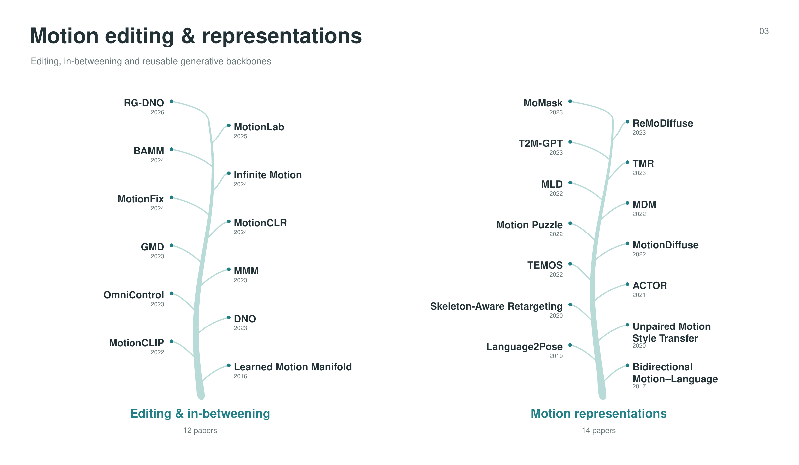
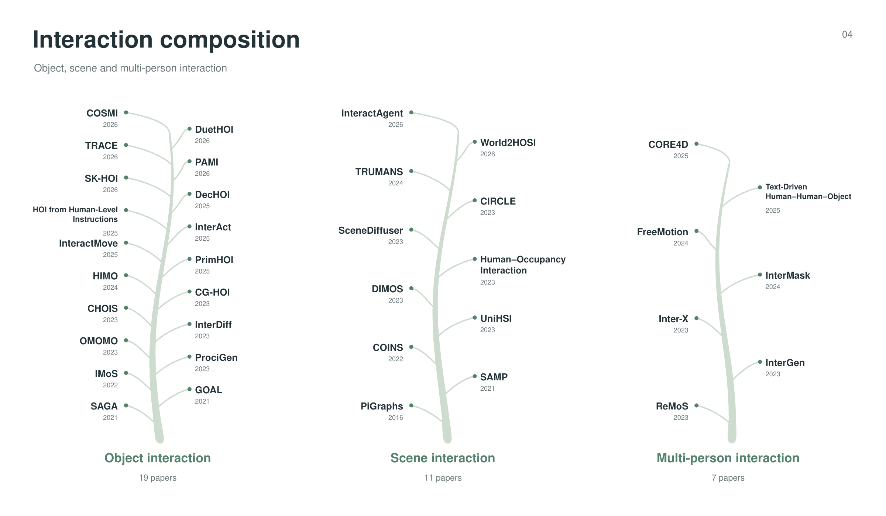

# Editable academic taxonomy

[Download the editable PowerPoint](compositional-human-motion-taxonomy.pptx)

The deck uses native PowerPoint text, shapes and connecting lines. Paper labels link to their primary sources. The PNGs below are high-resolution slide renders; use the [interactive map](https://yutao-yang.github.io/awesome-compositional-human-motion/) for searchable, expandable audit cards.

Typography: Nimbus Sans headings and diagram labels. The six-slide redraw follows the user-selected natural branching direction: bottom-rooted trees, tapering editable stems, alternating paper twigs, restrained teal, green, ochre and slate colors. Overview categories show representative works; five detailed pages contain all 138 papers exactly once. Paper years denote first public preprints, while publication and inspected-revision years remain separate in the catalog.

The [3D and 4D World Modeling survey](https://worldbench.github.io/survey) provided a visual layout reference selected by the user. This is an original redraw using this catalog's taxonomy and bibliography; no third-party figures, logos or data are embedded. Branch geometry and height are visual organization, not quantitative performance or scientific ancestry. Full titles, versions and source URLs are retained in slide notes and the paper catalog.

## Overview

## Motion composition

## Motion editing and representations

## Interaction composition

## Data and execution

## Related fields

