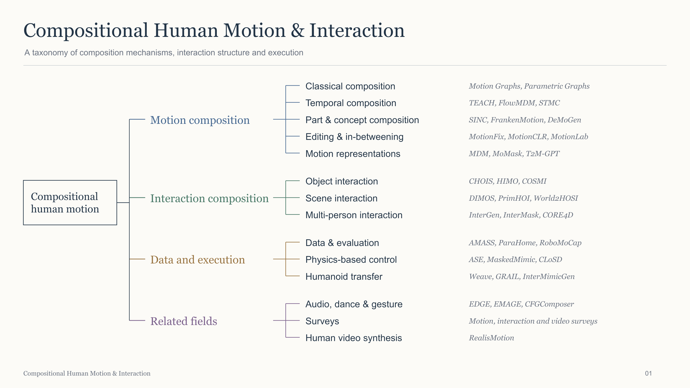
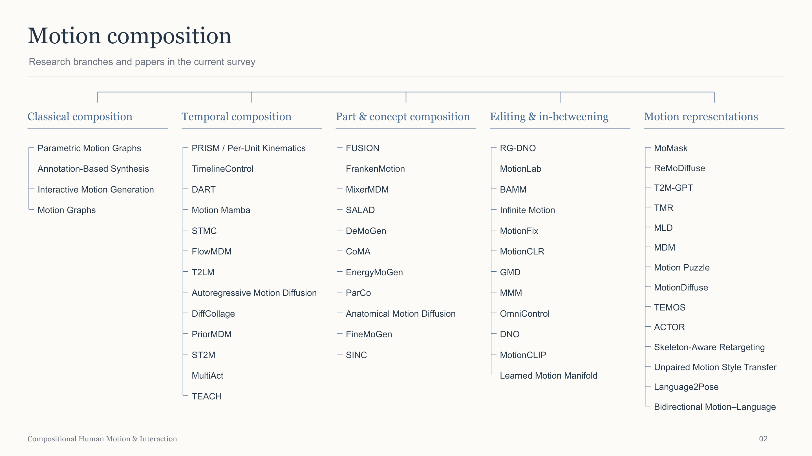
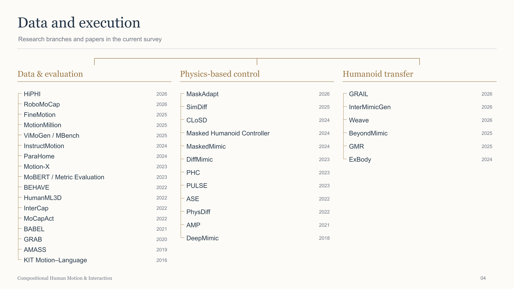
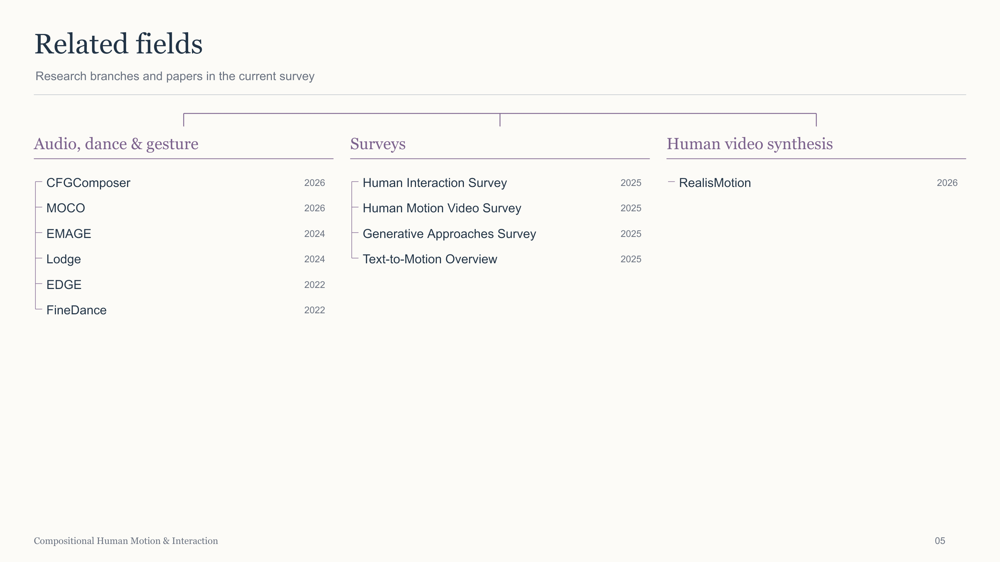

# Editable academic taxonomy

[Download the editable PowerPoint](compositional-human-motion-taxonomy.pptx)

The deck uses native PowerPoint text, shapes and connecting lines. Paper labels link to their primary sources. The PNGs below are high-resolution slide renders; use the [interactive map](https://yutao-yang.github.io/awesome-compositional-human-motion/) for searchable, expandable audit cards.

Typography: Georgia headings and Arial diagram labels. The taxonomy groups research questions; branch membership is a navigation aid, not a claim that methods use identical conditions or evaluation protocols. Full titles, versions and source URLs are retained in slide notes and the paper catalog.

## Overview

## Motion composition

## Interaction composition

## Data and execution

## Related fields

